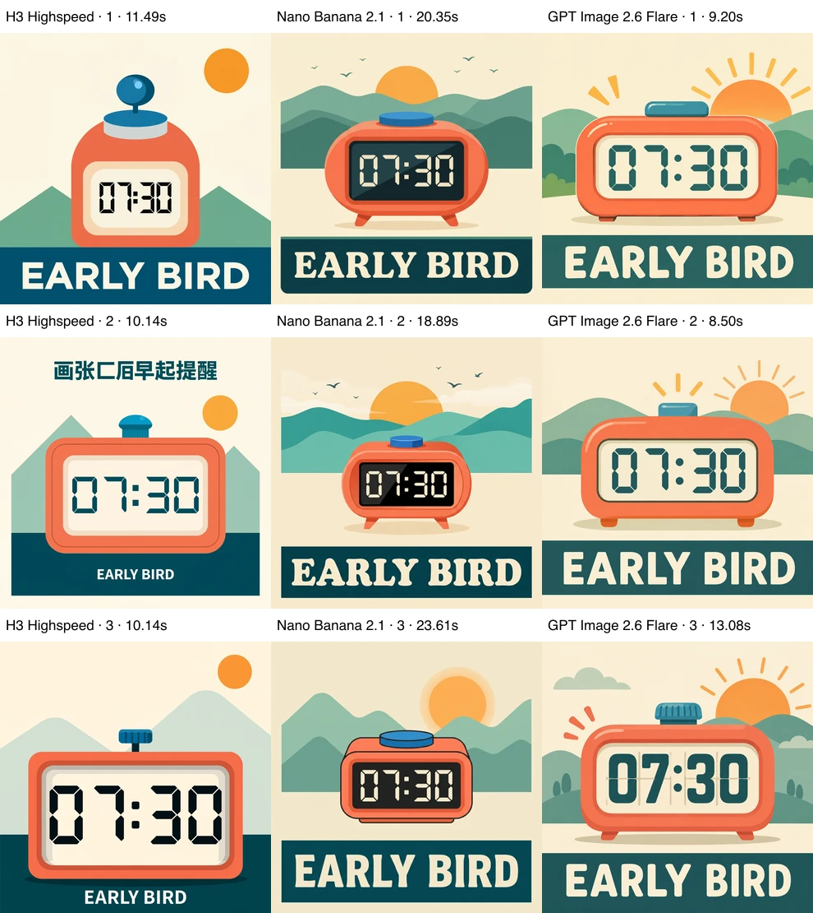
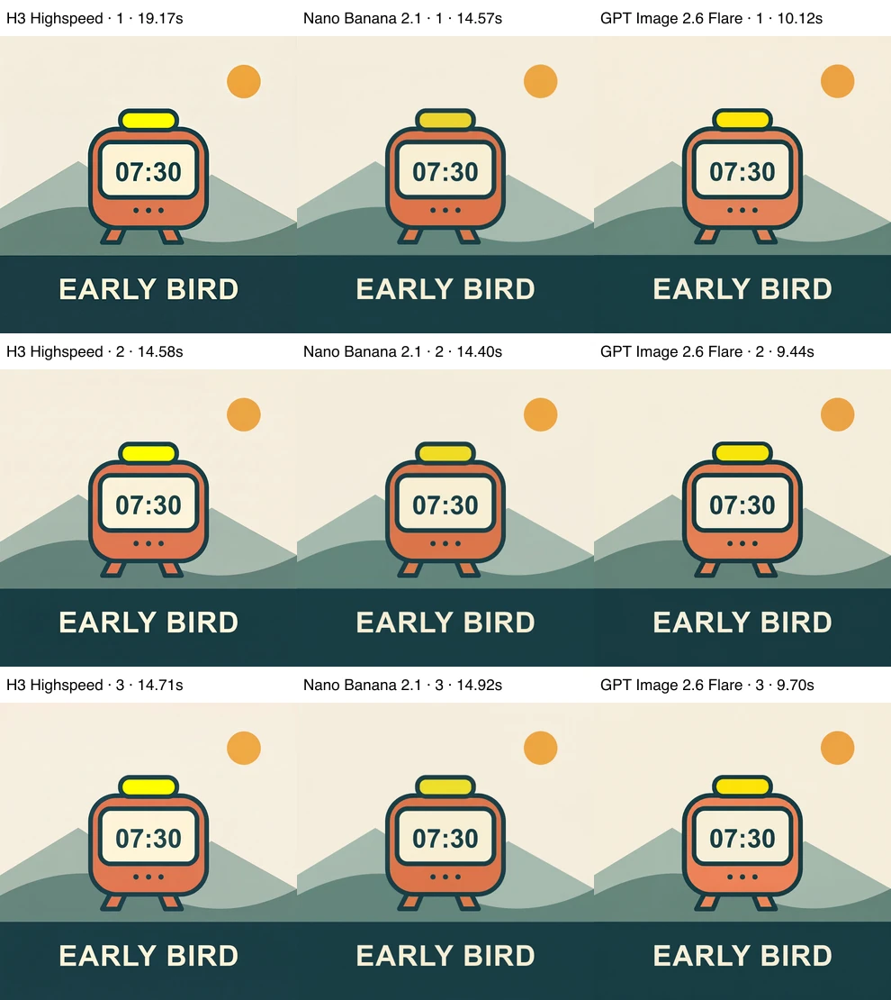

# H3 Image Highspeed 在语音出图场景的 1K 实测

**结论：保留实验，维持 Makaron 和 V 现有路由。** H3 的首次可见中位数是文生图 **10.14 秒**、轻编辑 **14.71 秒**。文生图比 Nano Banana 2.1 快约一半，Flare 在两项的中位数都是最短。H3 最快一次的供应商推理也用了 4.91 秒，已超过 1–2 秒目标。

2026-11-20 在上海 Mac 上，从 Makaron 的 `origin/dev` 提交 `b8bd25890245de346fd8ba26d100bdd3e55be903` 做本地测试。每个模型每项 3 次，串行，同一用户指令、1K 方图、单张输出。生成早起提醒卡，轻编辑只将现成卡片顶部的蓝色按钮改为明黄色。所有编辑引用同一个 PNG 原件。1K 是 Nano 的默认分辨率，本次未做 4K 或 V 用户尺寸频率统计。[输入原图](evidence/source.png) · [完整提示、输入哈希与接口报价](evidence/prices.json)

## 实际等待时间

下表是 18 个主样本。括号是三次中的最短和最长，其余耗时均为三次的中位数，单位为秒。费用是单张供应商实际用量计价的范围。原图可从逐次记录的 `file` 字段定位。[逐次时间、用量、原图哈希和像素测量](evidence/samples.json) · [原图目录](evidence/)

| 操作 | 实际模型 | 首次可见（范围） | 项目保存完成 | 从数据库和 CDN 读回验证完成 | 单张 USD |
|---|---|---:|---:|---:|---:|
| 生成 | H3 Highspeed | **10.14**（10.14–11.49） | 12.81 | 14.68 | 0.03130 |
| 生成 | Nano Banana 2.1 | 20.35（18.89–23.61） | 25.84 | 27.77 | 0.04192–0.04460 |
| 生成 | GPT Image 2.6 Flare | **9.20**（8.50–13.08） | 11.30 | 13.16 | 0.02520 |
| 轻编辑 | H3 Highspeed | **14.71**（14.58–19.17） | 17.94 | 19.67 | 0.04279–0.04498 |
| 轻编辑 | Nano Banana 2.1 | 14.58（14.40–14.92） | 16.82 | 18.32 | 0.03862–0.03959 |
| 轻编辑 | GPT Image 2.6 Flare | **9.70**（9.44–10.12） | 12.58 | 14.91 | 0.03324 |

| 操作 / 模型 | 供应商 POST 发起至原始图片收齐¹ | 服务端队列 | 模型推理 | 图片下载² |
|---|---:|---:|---:|---:|
| 生成 / H3 | 10.10 | 0.049 | 4.99 | 2.54 |
| 生成 / Nano | 16.15 | 未披露 | 未披露 | 0.47 |
| 生成 / Flare | 5.69 | 未披露 | 未披露 | 0.40 |
| 编辑 / H3 | 14.64 | 0.046 | 8.01 | 2.99 |
| 编辑 / Nano | 10.78 | 未披露 | 未披露 | 0.34 |
| 编辑 / Flare | 6.51 | 未披露 | 未披露 | 0.64 |

¹ 包含客户端向供应商提交、等待和收取结果的时间。H3 含轮询与 CDN 取图。OpenRouter / OpenAI 返回同步 JSON，无法从首个响应头分离纯推理和排队。

² H3 计独立 CDN GET 至完整文件；另两者计收到响应头至完整内联图片响应体读取结束。H3 队列取 fal 回执的 `started_at − sent_at`，模型推理取结果的 `timings.inference`。各列有重叠。最慢 H3 编辑（19.17 秒）在 4.98 秒收到提交回执，服务端排队 46 毫秒，推理 7.99 秒，最后 CDN GET 用了 2.99 秒。仅缩短轮询无法达到 2 秒。[fal 服务端时间](evidence/fal-account.json)

**可见与持久化的边界。** 从本地发起该次创作开始计时。首次可见取 Chrome 实际载入图片、完整解码并跨两个动画帧的时间，是一次绘制机会的上界。保存走本地代码的 `/api/projects/create` 向同一专用测试项目追加原图，再读回对应快照行和 CDN 字节，核对 SHA-256。18/18 主样本通过。保存和读回均为从创作开始的累计时间。H3 的实验路径没有产品鉴权或积分结算，给了候选较有利的首次可见条件。上述 UI 是测试页面。V 的现有受限媒体适配器只接受指定的 Nano 模型，未测 V 真机语音结束到图片上屏，也未测线上编辑器首绘。

## 请求走到了哪里

| 显式选择 | 请求与质量档 | 实际供应商和 fallback |
|---|---|---|
| H3 Highspeed | `minimax/h3-image/highspeed/text-to-image` 或 `.../edit`，1024×1024 PNG，1 张。生成关闭扩写。编辑走公开 schema 的默认处理 | fal Partner 队列。仅向接受的原任务查询。编辑主样本 3/3 返回经过改写的提示。 |
| `gemini-2.1` | 仓库 CLI → `makaron_edit_image` → 共享 `editImage`，`1K`、`1:1`，原生质量，返回 JPEG。产品会添加仅输出图片的提示，编辑另加底图角色说明 | OpenRouter `POST /api/v1/images`，模型 `google/gemini-nano-banana-2.1`。六次均未换路。 |
| `gpt-image-2.6-flare` | 同一 CLI / MCP / Agent 共享图片工具。沿用当前默认的 low quality、high complexity、PNG，1K 方图 | 六次均直达 OpenAI `/v1/images/generations` 或 `/v1/images/edits`。登记的同模型备用供应商是 fal `openai/gpt-image-2.6/flare/{text-to-image,edit}`。本次没有触发供应商或模型回退。 |

当前普通图片默认由能力表选 Flare。明确选型进入现有注册、预检、扣费、供应商路由及文件保存逻辑。主测试未调用推理 Agent 来改写用户需求。实验对每个样本在第二次供应商提交前停止，独立保留失败/未知状态。分档设置彼此不同，质量目标统一为能直接读出时间和标题、编辑只改按钮。[能力定义](../../src/lib/image-model-capabilities.ts) · [图片注册与计费策略](../../src/lib/models/index.ts) · [CLI 调用的 MCP 工具](../../src/mcp/server.ts) · [Agent 图片工具](../../src/lib/skills/edit-image.ts) · [Flare 供应商路由](../../src/lib/models/openai-image26.ts)

**编辑合同的复核。** 初始 18 次按轮次轮换模型顺序。最初的三次 H3 编辑也发送了生成接口的 `enable_prompt_expansion:false`，均返回图片，可见耗时 14.83、16.38、17.61 秒。核对官方 OpenAPI 后，使用文档列出的编辑字段单独重测三次，这三次进入主表。因此主表中 H3 编辑与两款对照采样时段略有错开。原始三次仍保留在附录，计入总费用。在线价格复查曾有一次未读到报价，在发出新生成 POST 前停止，随后沿用本轮已取得的报价。所有媒体 POST 均成功，每次只提交一次。[初始三次记录](evidence/preliminary.json) · [文生图 schema](https://fal.ai/api/openapi/queue/openapi.json?endpoint_id=minimax/h3-image/highspeed/text-to-image) · [编辑 schema](https://fal.ai/api/openapi/queue/openapi.json?endpoint_id=minimax/h3-image/highspeed/edit)

## 主体、文字与局部编辑



九张生成图都能读出“07:30”和“EARLY BIRD”。H3 第 2 张额外画了一行近似中文的错字，第 1 张的按钮更像带柄圆球。Nano 和 Flare 的六张图都保持了可辨认的闹钟和要求的标题。这个样本能检验短文本和单一主体，无法估计其他题材的拒绝率。



九张主编辑图都将按钮改黄，钟面、标题、山和太阳仍可辨。用底图按钮的 8,400 个纯蓝核心像素作定位，H3 有 98.0%–99.96% 变黄。扩大按钮包围框后检查框外像素，任一 RGB 通道比底图相差超过 16 的占比，H3 为 1.93%–2.98%，Nano 为 1.33%–1.40%，Flare 为 0.98%–1.37%。这是原始输出与底图之间的变化，包含重新渲染和编码差异。三个后端均只收到底图与指令。H3 编辑 schema 没有独立 mask 参数，不能承诺保护区域外逐像素不变。

另做一次 H3 透明 PNG 专测，明确要求轮廓外 alpha 为零。下载结果是白底 RGB，1,048,576 个像素里非不透明像素为 **0**。两个 H3 schema 都没有透明背景参数。这个接口不能承接 Makaron 的真透明输出合同。[透明专测原图](evidence/alpha.png) · [通道统计](evidence/alpha.json)

## 费用与 fal 权限

- 开跑前，fal 价格接口对两个 H3 endpoint 都报每计费单位 $0.001。模型页列出每千万 token 的费率，文字输入 $23、编辑图像输入 $30、图像输出 $76。据公开示例估算，短提示的 1K 单图约 $0.03–0.05，实验为每个未结样本预留 $0.50。Makaron CLI 当时的预检报价，Nano 生成/编辑为 7/8 积分，Flare 为 6/9 积分。[生成价格](https://fal.ai/models/minimax/h3-image/highspeed/text-to-image) · [编辑价格](https://fal.ai/models/minimax/h3-image/highspeed/edit)
- 主表 18 张 **$0.6479876**；初始三次编辑 $0.1330586；透明能力测试 $0.0312055。**22 次合计 $0.8122517**。供应商小计为 fal $0.3908012、OpenRouter $0.2461395、OpenAI $0.1753110。前者取实际响应的 billable units × 本次接口单价，OpenRouter 取 `usage.cost`，OpenAI 用实际分类 token × 仓库现行供应商费率。两款已接模型通过真实 CLI 共扣 **90 积分**，与供应商 USD 属于两种度量。H3 未注册定价或产生 Makaron 积分扣费。
- fal 的推理 key 确实获准调用两种模型，也能按原请求读取服务端计时。逐笔账单接口返回 HTTP 403，因此 fal 数字为实际用量的折前金额。官方曾公布至 11 月 23 日的限量免费额度，此账户最终折扣和净扣款未知。[fal 活动与商用说明](https://fal.ai/minimax-h3-image) · [账单接口定义](https://api.fal.ai/v1/openapi.json)
- 两个端点标为 Commercial use / Partner，fal 明确允许经其 API 生成的内容用于商业项目。服务条款允许通过产品后端向终端用户提供能力，要求保护凭据、具备输入权利并遵守终端用户条款；Partner 模型的输入可转交第三方处理，输出并无独占或不侵权保证。这里核对的范围是经 fal 提供的服务及其产物；自托管权重与独立模型分发需要单独的许可依据。[模型说明](https://fal.ai/minimax-h3-image) · [fal 服务条款](https://fal.ai/legal/terms-of-service) · [API 补充条款](https://fal.ai/legal/api-services)

## 复现与验证

在仓库根目录运行。离线复核会完整解码主样本、检查尺寸与 SHA-256、重算按钮及透明度指标并生成对照图。

```sh
bench=benchmarks/h3-image-highspeed
node "$bench/review.cjs" "$bench/evidence" .tmp/h3-reviewed
diff -qr "$bench/evidence" .tmp/h3-reviewed
```

真实复现使用项目依赖、Chrome、已授权的 Makaron per-user CLI 登录、正常供应商凭据，以及相应测试环境的项目存储。每次运行使用独立目录，同一目录保留每个样本在首个 POST 前创建的日志；重启跳过已有日志。中断后 fal 已接受回执保存在该目录的 `*.private.json`，可按其中的 URL 只读回查。账单核对可选。下例会在已配置数据库创建专用测试项目并消费真实额度。

```sh
bench=benchmarks/h3-image-highspeed
run_dir=.tmp/h3-reproduction
node --env-file=.env.local --import tsx --require ./md-loader.cjs "$bench/run.cjs" "$run_dir" --paid
node --env-file=.env.local "$bench/alpha.cjs" "$run_dir" --paid
node --env-file=.env.local "$bench/audit-fal.cjs" "$run_dir"
node "$bench/review.cjs" "$run_dir" .tmp/h3-reviewed-live
```

默认复现使用公开 schema。如需复核本次历史采样顺序，初始矩阵额外传 `--original-wire`，然后以同一目录运行 `run.cjs … --paid --edit-contract-check`，再生成报告。私有日志、账户标识、存储 URL 和 API key 均不在证据包内。

8 个既有测试文件、166 项通过，覆盖 MCP 图片选型、能力冲突、Nano 供应商/计费及 Flare 的 OpenAI/fal 路由。另已验证公开证据包离线重建一致。此 PR 仅包含实验代码、素材与证据，尚不具备发布条件。
