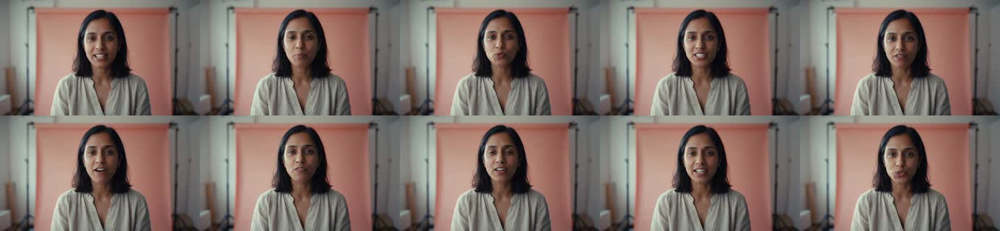
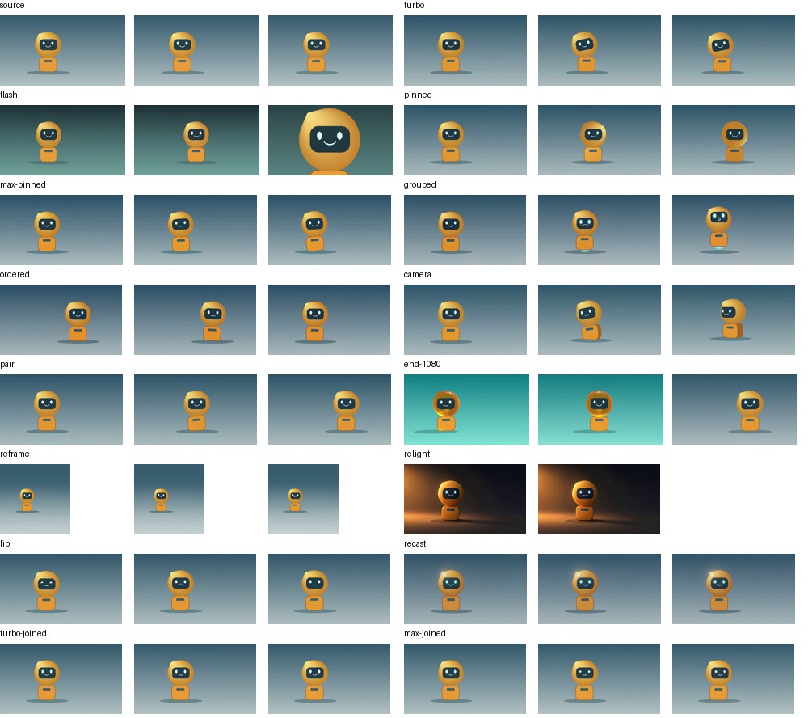

# fal H3 Max / Turbo 显式控制候选 · 2026-11-20

**保持 Draft。** 现有 Kling 4.0 Flash、Max 与 Turbo 的选择和普通请求合同沿用 dev。所有新能力默认关闭。原分组参考、Retake 首/中/尾帧和 Turbo 单首帧有回归测试。普通 Max 的两对样本顺序翻转后快慢也翻转，无法据此接受发布级延迟。Turbo Extend 本轮慢于 Max Extend。

## 协议与可用入口

从 `b8bd25890245de346fd8ba26d100bdd3e55be903` 建独立分支。Max Extend 对照直接使用 [PR #5](https://github.com/vegekyd-sys/ai-image-editor/pull/5) 的已验证短尾方法和完整返回模式，保留它原有的 60.387 秒成片与曾出现 504 的记录。本候选没有带入 PR #5 的 Max Extend 代码、价格迁移或 Agent 长视频编排，也没有改动该 PR。2026-10-31 已搁置的 Turbo Reference 多参考对照未重跑；旧样本 Max/Turbo 推理 15.42/14.16 秒，取回 URL 耗时包含重查。

| 操作 | 本轮证据 | 发布状态 |
|---|---|---|
| Max / Turbo 锁定音轨 | T2V 或带视觉输入的生成传 `target_audio_url`，拒绝与独立参考声音混用。两条真实 I2V 样例的输出与输入语音波形相关系数均四舍五入为 1.0000，最佳偏移 0 ms。短音轨供应商补静音，长音轨取前段。T2V 走适配器测试。 | 显式实验 |
| Max 混排参考 | `[角色图、动作视频、声音、服装图]` 按顺序提交为 `reference_conditions`，与三组 URL 字段互斥。`<<<media_4>>>` 绑定 Image 2，类型内编号仍独立。专用样例保留琥珀色机器人并穿上第四项的绿色夹克；没有量化动作或节奏保真度。 | 显式实验；未核价的参考组合在提交前停止 |
| Max 独立镜头轨迹 | `camera-controls`，客户端提交 0–1 时轴的方位、仰角和距离。真实样片从正面移动至侧面。 | 显式实验 |
| Turbo 显式 1080p、首尾帧或仅尾帧 | 1080p 为 768p 潜空间精修；仅尾帧实测输出 1920×1080，首尾双帧从左移向右。既有单首帧默认 768p。 | 显式实验 |
| Turbo Extend | `extend-video` 返回含短尾的完整视频。同一 2 秒尾段对照详见下文。 | 慢于 Max，本轮不开放给普通用户 |
| Max Relight / Reframe | 单独端点分别接收照明球、目标画幅；暖侧光和 1:1 扩画可见，均保留源音。Relight 5 秒源实际裁至 107/24 秒；Reframe 候选只按短单窗口计费。 | 显式实验，未证明显著同类提速 |
| Max Recast | 官方接口已返回文件，单次 153.04 秒。本轮机器人夹具没有可验的真人替换，且费用随逐镜头输入 token 变化。 | 请求构造已测；产品提交关闭，无价格行 |
| 照片口型 | `lip-sync/image-to-video`，fal 示例照片 + 合成语音；17.68 秒可解码，可见连续口型变化，原语音波形匹配。 | 显式实验，未做逐音素人工验收 |

候选只在指定服务设置 `MAKARON_H3_EXPERIMENTS`（按逗号列出控制种类）时接受对应操作。GUI 使用编译时 `NEXT_PUBLIC_H3_FRAME_EXPERIMENT=1`，在 V2 编辑器选中 fal H3 Turbo 后从状态栏进入关键帧面板。桌面和移动设备的物理体验尚未验收。Agent 支持显式 timeline 索引和独立 audio refs；MCP/CLI 共用已测量的输入和原 task 回查。CLI 使用 `--h3-controls`，旧服务未声明该参数时停止。命令和示例见 [CLI README](../../../packages/makaron-cli/README.md#explicit-h3-operations-candidate-deployments)。

## 延迟、样片与费用

[28 个真实任务的分项时钟、供应商用量和视频](timings.csv)。普通链路 5 秒、16:9，H3 比较档 768p；混排新旧与续写成对使用 480p。Flash 只支持 720p，不能做同分辨率结论。样例均来自专用夹具；普通场景用同一张机器人图和镜头提示。直接供应商对照复用同一文本；从产品入口测试的旧/新普通请求复用同一带媒体标记的文本和相同字节。新特性按需增加参考音频、尾图或结构化轨迹。未固定随机种子。每个操作通常一个样本；相同任务提交间有不同网络和队列条件。

| 5 秒任务 | 基线首帧可解码 | 候选首帧可解码 |
|---|---:|---:|
| 普通 Turbo，产品 createVideo | 14.26 s | 10.61 s |
| 普通 Max，两组产品 createVideo（第二组先跑候选） | 11.59 / 19.05 s | 15.44 / 14.23 s |
| 同素材相同供应商设置，Max 分组 / 混排参考 | 34.28 s | 25.59 s |
| Max / Turbo 短尾续写 | 66.12 s | 88.08 s |
| 供应商侧单图档：Kling Flash、Max、Turbo | Flash 75.18 s，Max 14.74 s | Turbo 11.54 s，锁声 10.99 s；产品锁声含预检 19.31 s |
| Turbo 仅尾帧 1080p、双帧 768p；Max 镜头轨迹 768p | — | 11.56 / 10.82 / 14.95 s |

CSV 的 url 可直接播放，media 对应本地归档文件名。准备耗时计至 POST 前；首次观察到运行提供队列等待的上界。后台未披露精确排队时钟，空格表示未采集。worker 包含调度后的准备/拼接，denoise 是供应商单报的推理。状态回查、下载落盘和第一帧解码分别计时。可解码指标来自本机 FFmpeg；项目实测另列首次可用 URL 和确认永久存储。并未将这些数字当成浏览器点击播放延迟。无法由单轮相对 Flash 的优势外推到不具有相同操作的模型。

Turbo/Max 续写供应商 worker 为 81.91 / 59.19 秒左右（实际值见 CSV）；Turbo 的 prompt expansion、generation、stitch 分别为 26.13、51.57、5.60 秒。核心去噪 0.98 秒仍不足以弥补端到端差距。两条返回视频均为 7.667 秒，前 48 帧是送入的短尾。剪去这 48 帧和相应 2 秒音频，再接回 5 秒母片，得到 10.667 秒的 H.264/AAC。拼接点前后抽帧可见主体连续，原 5 秒前段音频相关系数 0.9989、0 ms 偏移。该结果适用于 `output=extended`；单独 continuation 模式的合同为 1.625 秒重叠。

[Max 续写拼接成片](https://cdn.makaron.app/storage/v1/object/public/images/candidate/h3-explicit-318199c5-36e9-4fc1-9a60-b20fa894a729/max-joined.mp4) · [Turbo 续写拼接成片](https://cdn.makaron.app/storage/v1/object/public/images/candidate/h3-explicit-318199c5-36e9-4fc1-9a60-b20fa894a729/turbo-joined.mp4) · [混排服装样片](https://v3b.fal.media/files/b/0ab32a43/tvJFf9BR8Zvr7rT0UcFOs_minimax-h3.mp4) · [照片口型](https://v3b.fal.media/files/b/0ab32a1b/dkIqRQhAvaSpdq0IRGyfK_dubbed.mp4)

首轮 fal estimate 对九个端点各取 5 个计量单位，得到 $1.90625。实际汇总使用每个 fal 回执的 billable units × 当次账户单位价，Kling 使用回执 USD。**28 项合计 $8.42362**，包括专用项目首次扣费异常的样例与修复复验；超出 $5 目标，低于 $10 上限。此数为本次媒体请求计量，未查月账单。Makaron 积分按产品价卡计算，账户折扣独立。

## 计费和保存验收

- 四项混排的供应商回执为 8,728 个参考 token。两张 16:9 图共 3,648，48 帧动作视频在 480p 为 4,680，5 秒声音为 400。共享免额 4,096；5 秒输出 $0.25 加参考 $0.09264。CLI 本地询价、实际提交报价均 69 积分，fal 回执 $0.34264。候选对视频参考只开放供应商有确切帧数样表的组合；输入视频按真实帧数探测。其他部分按公开时长费率。Recast 停在逐镜头计费前。
- 新迁移在独立 PostgreSQL 16 实例实际执行并读回 16 行；共享数据库未应用迁移。CLI 经真实 MCP 工具提交仅尾帧 1080p 并以原 ID 回查。该轮使用隔离价卡（5 秒 80 积分）与本地计费回调，未作共享账户扣费。
- Chrome 实际操作渲染的关键帧面板，首尾模式才出现 1080p，5 秒显示 80 积分，提交参数核对通过。内置浏览器此次返回 unavailable。浏览器夹具只验证 UI。另用本地完整 Next 构建、真实鉴权和专用项目执行正式快照 API。
- 第一次项目样例报价 40、记录扣费 0，暴露快照路径缺少计费回调。修复后新建仅尾帧任务，实际扣 40 积分，3.90 秒收到持久化回执，10.16 秒有播放 URL，12.90 秒本地首帧解码，16.17 秒确认永久存储且重开可读。初始测试样例未追补积分。[修复后的项目视频](https://cdn.makaron.app/storage/v1/object/public/images/5955d413-cad2-4814-b094-7fdf62d20400/7f60378c-9d1e-4bcb-9e5b-c075d2496f00/videos/55661bff-d2f1-48a6-8eb7-302dd6f6eb2e.mp4)
- 本轮 28 次付费提交都产出视频。慢样本、输出偏差与计费失败如上。Agent 工具工厂用真实选择、选图索引与回调测试；未运行线上 LLM 自主选工具，也未在实体手机验收。未合并、发布 npm、部署生产或占用共享 Preview。

核验使用生产模式 Next 构建、TypeScript、198 个相关 Vitest 用例、CLI smoke、四语检查、Agent 启动检查和视频参考工作流检查。可在 [fal Max 参考合同](https://fal.ai/models/minimax/h3-max/reference-to-video/api)、[Turbo I2V](https://fal.ai/models/minimax/h3-max-turbo/image-to-video/api)、[Turbo Extend](https://fal.ai/models/minimax/h3-max-turbo/extend-video/api)、[Camera Controls](https://fal.ai/models/minimax/h3-max/camera-controls/api)、[Relight](https://fal.ai/models/minimax/h3-max/relight/api)、[Reframe](https://fal.ai/models/minimax/h3-max/reframe-video/api)、[Recast](https://fal.ai/models/minimax/h3-max/recast/api) 和[照片口型](https://fal.ai/models/minimax/h3-max/lip-sync/image-to-video/api)核对字段。
