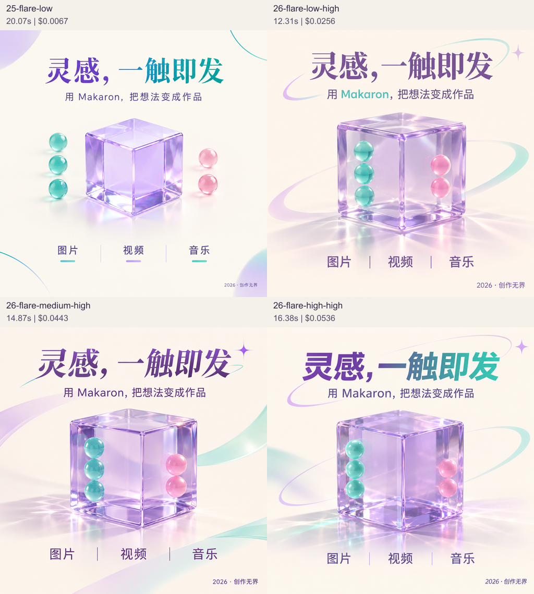
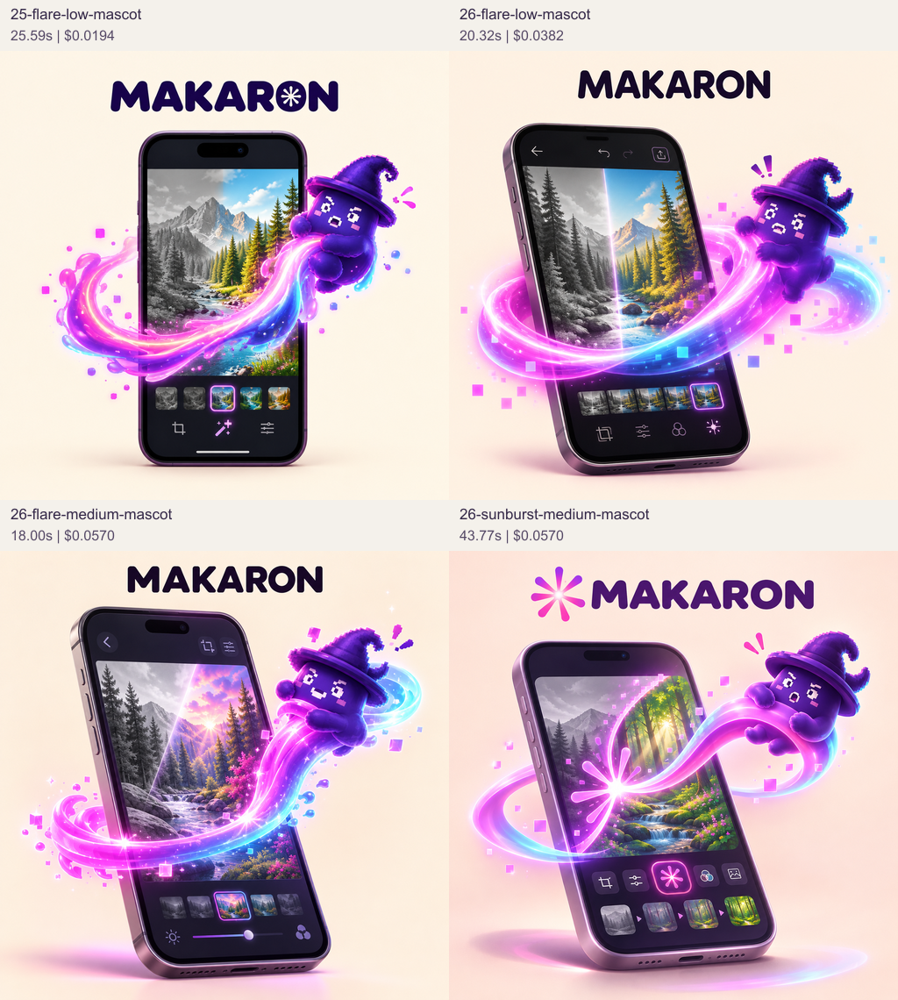
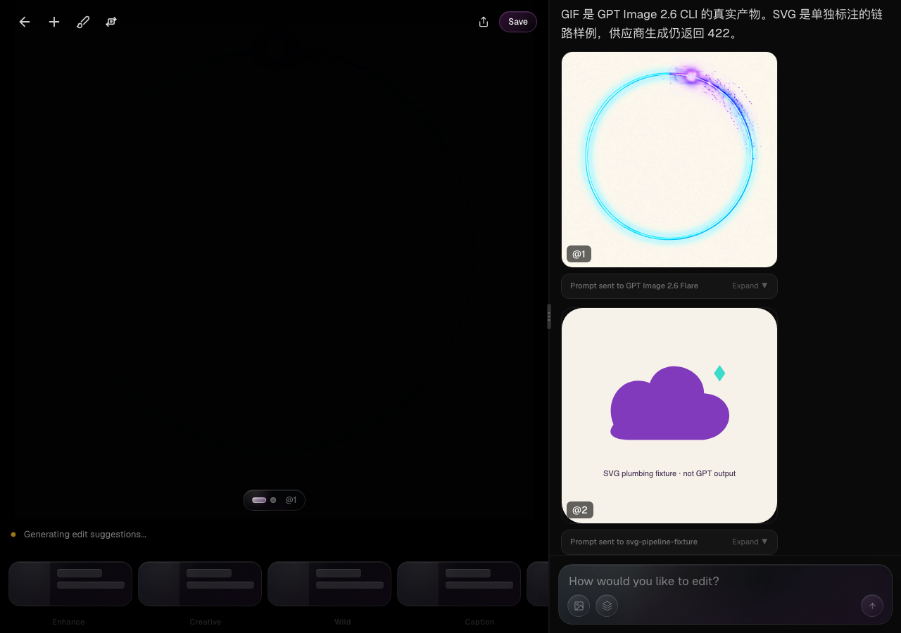
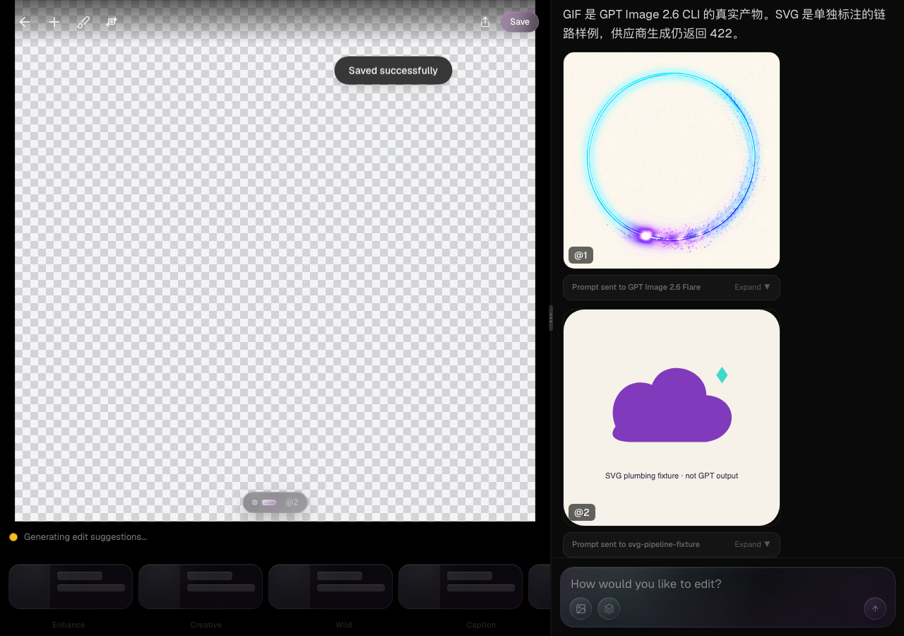

GPT Image 2.6 全面升级候选与实测

独立 worktree：`/Users/tianyicai/.codex/worktrees/gpt-image26-candidate/ai-image-editor`，分支 `codex/gpt-image26-candidate`，基线 dev `44ff92af51c457e16d9ce4162a5bbf7e25321dfc`。业务代码提交依次为 `15442840`、`f4ec9867`、`85cbe9c1`、`b1dcd2fd`。共享 checkout、共享数据库、Preview 配置及默认线上路由没有在本任务中修改；没有 push、PR、合入、部署或 NPM 发布。

候选默认已设为 **GPT Image 2.6 Flare，quality=low、reasoning_effort=high**。2.5 从新的 GUI/Agent/CLI 模型选择中移除；旧 2.5 Flare/Sunburst 请求映射到对应 2.6，旧作品的模型信息和账目保留。图片推理与 Agent LLM 推理是不同参数，不能混为一谈。

PNG、参考编辑、GIF、CLI、实际 Editor 保存/重开，以及管理员 Codex Subscription → 通用图片工具链路有真实证据。**整体尚未通过完整验收：fal SVG 生成仍然失败。** SVG 文件处理代码与显示/下载链路已验证，界面标注 SVG 试验，不能称 SVG 模型生成已接好。

[交互对比页](http://127.0.0.1:3048) 可选左右样例、放大和下载原文件；`comparison.html` 是同目录可打开的离线报告，媒体以相对路径加载。复现：`node evidence/gpt-image26-upgrade/gallery.mjs`。这是本机结果页面，不是线上发布。

**同素材比较。** `manifest.json` 保存测试提示词、精确模型端点、参数矩阵、参考图 SHA-256；每个目录的 `receipt.json` 保存唯一任务、单次提交、时间、计费 header 结果和输出 SHA-256。参考编辑使用同一份 Makaron Spark + Pixel Wizard 官方角色图，没有给不同模型更换素材。基线明确为 fal GPT Image 2.5；旧代码显式 quality=low，但没有发送推理参数，不能把供应商默认值称为 low 推理。

成功得到 27 个基准产物，加上真实 CLI GIF、普通 Agent PNG、管理员订阅 Agent PNG，共 30 个真实模型产物。另有 7 个终止 422 记录：xhigh/max 的实际拒绝，以及 Flare/Sunburst/最小参数三次 SVG 请求；已知不支持的剩余组合记录 filtered，没有伪造输出。失败样本和首次测试失败日志保留。

| 对比，均为 1024×1024 中文海报 | 总耗时 | 单张供应商费用 |
|---|---:|---:|
| 2.5 Flare low；推理接口未暴露，3 次 | 中位 20.88s，20.08–21.81s | $0.0067 |
| 2.6 Flare low/high，3 次 | 中位 11.78s，11.02–12.31s | $0.0256 |
| 2.5 Flare medium | 21.02s | $0.0140 |
| 2.5 Flare high | 26.96s | $0.0535 |
| 2.6 Flare medium/high | 14.87s | $0.0443 |
| 2.6 Flare high/high | 16.38s | $0.0536 |
| 2.6 Flare auto/high | 14.66s | $0.0443 |

这一个场景里默认候选比原 low 基线中位耗时少 43.6%，费用约 3.82 倍。只有 3 次复测，不推断全场景性能或 P95；auto 返回的价格也不能用于反推内部实际画质档。

| 2.6 Flare，quality × reasoning，每档 1 张 | low reasoning | medium reasoning | high reasoning | 每张费用 |
|---|---:|---:|---:|---:|
| low quality | 12.63s | 12.56s | 12.31s | $0.0256 |
| medium quality | 13.33s | 16.33s | 14.87s | $0.0443 |
| high quality | 10.96s | 17.79s | 16.38s | $0.0536 |

fal schema 虽列出 xhigh/max，实际端点返回 “Reasoning effort … is not supported”。产品只开放已实际接受的 low/medium/high。原生 OpenAI 的 complexity 三档与 fal 的 reasoning_effort 字段分开记录，没有混用。供应商没有回传内部推理轨迹或档位 echo；证据能证明显式请求字段、指定端点与结果，不能保证内部计算量。

视觉观察：海报各档主要文字与三颗青球/两颗粉球都基本遵从，提高画质主要改变玻璃材质、光影和构图细节，没有观察到推理逐档升高就稳定变好。参考编辑中 Flare 2.6 保留了帽子、紫色角色、Spark 与手机交互，medium 的光影更复杂；Sunburst 样例更装饰化。这是人工看实际像素的观察，不是盲测得分。Sunburst 同一海报 low/medium/high 分别 26.29/152.31/43.86s，不能称它稳定更快。原图和失败记录都在对比页中。

**格式与产品链路。** 新参数为 `imageQuality`、`imageReasoningEffort`、`outputFormat`、`frameCount`、`frameDurationMs`，贯穿 Agent 工具、共享 edit-image Skill、MCP HTTP/stdio 与 CLI。默认 PNG；GIF/SVG 保留原件，不进入 JPEG 静态化处理。SVG 限纯文生图，不接受源图/参考图；静态 XML 校验拒绝脚本、外部资源、嵌入位图及不支持的元素，GUI 用 img 呈现。

GIF 各帧共享像素预算，默认 9 帧/200ms，默认方形按 960×960 规划；具体画布或帧数不满足预算时，在付费前失败。公开 schema 的 64 帧上限不表示每个尺寸都可用。两种模型的真实 GIF 生成/参考编辑已返回；没有以首帧代替动画。

| 实际验收项 | 结果与证据 |
|---|---|
| CLI → HTTP MCP → fal GIF → 本地文件 | `cli-live-gif.log`、`cli-spark.gif`：960×960，9 帧，160ms/帧、循环；$0.1471，实际账本 30 credits |
| GIF 原件存储 | `product-persistence.json`：实际本地 Supabase Storage MIME=image/gif，上传/下载逐字节相同 |
| 实际 Editor GIF 展示/Save/重开 | `ui-verification.json`：画布两次采样帧有像素差异；Save 的文件名为 .gif 且字节与原件相同；重新打开仍可显示 |
| SVG GUI/Save/重开 | 使用 `svg-pipeline-fixture.svg`，画面直接写明 “not GPT output”；实际 Storage/Editor/下载保留 .svg 和原始 XML 字节。只证明文件链路 |
| SVG CLI 回传 | CLI 自动测试以明确的合成 MCP 传输样例验证 MIME、.svg 后缀及 XML 字节；真实供应商 SVG 没有产物，不冒充端到端生成 |
| SVG edit 拒绝 | `cli-svg-guard.log`：带源图的 SVG 请求在付费前拒绝，没有偷偷改成 PNG 或抛弃参考图 |
| 真 SVG 模型生成 | `26-flare-svg`、`26-sunburst-svg`、`26-flare-svg-minimal` 全部终止 422 “Invalid request”；保持阻塞 |

真实 GUI 首选 IAB 检查，随后 Playwright 重复测试实际 Editor/实际数据库与对象下载。自动复测仅拦截不相关的命名、分析、tips，未 mock 媒体、存储或下载。最初未拦截的本地辅助分析产生了 fixture 缺价格及外部服务不能读取 localhost 的错误，旧日志保留，不将这部分称为通过。修复格式链路后创建干净测试项目，保留第一次失败项目，没有操作现有用户项目。

初次实际 Storage 拒绝 GIF/SVG，暴露原 bucket MIME 白名单。候选增加 `20261105022651_gpt_image26_media_formats.sql`，只在独立 `makaron-gpt26-e2e` 数据库验证，保留已有 MIME 限制，追加 gif/svg；共享库未应用。AgentDualWriter 现在在存储失败时明确失败，不发布无 URL 的完成快照。thumbnail/optimized URL 跳过 GIF/SVG 转换；GUI Save、MCP、CLI 的 MIME 与后缀一致。

**管理员套餐。** 普通真实 `makaron chat --project auto` 未在用户请求中选择图片模型，完成 Azure GPT-6 Luna → 通用 generate_image → fal 2.6 Flare → 图片单独扣费 → AgentDualWriter 保存 PNG，见 `agent-default-proof.json`。

管理员则复用本机现有 Codex 登录，以仓库原有 relay 源码运行隔离的 loopback 镜像，只允许专用本地测试账号。测试环境没有 Azure/OpenRouter 凭据，真实 `gpt-6-luna-codex-subscription` 请求成功生成并保存了 2.6 Flare PNG，没有 API fallback。账本记录 Agent `gpt-6-luna:codex-subscription` 0 credits，图片另按实际 fal 成本 $0.0255 扣 6 credits，见 `admin-subscription-proof.json`。订阅 Agent 不等于 fal 图片免费，也没有据此声称 Codex 原生图片 API 可用。

原生产 relay 的 read-only health 在 Node/curl/TLS1.2 均连接重置，没有改生产配置、重启生产服务或更改生产管理员名单。隔离镜像证明候选管理员链路可用；上线前仍需恢复/核对实际生产 relay。

**验证与费用。** 广泛回归 15 文件 222 tests 通过；最后涉及的子集再次 83 tests 通过，传输收尾 34 tests 通过（均有重叠，不能相加）。TypeScript、scoped ESLint 无错误（Agent 原有 unused locale warning 1 个）、四语 i18n guard、CLI smoke/upload 及 GIF/SVG 传输用例通过。实际选择器四语像素与交互验证通过，2.5 不再出现；`selector-final.json`。最终 UI 复测使用业务提交 85cbe9c1；后续 b1dcd2fd 仅收敛 server polling 到 240s 并尽早记录 accepted task ID，相关传输测试与 TypeScript 复核通过。

Skill build/check 通过，当前指纹的 3 个真实路由预检均在媒体生成前停止，`accepted.json` 与 `routing-live-final.log` 留有证据。CLI 0.17.9 候选 tarball 在全新临时目录安装，help 与原格式回传通过；没有发布 NPM，因此不是 registry 发布验收。

供应商已回传的成功图片费用合计 **$1.3026**。两轮受控路由与普通 Agent 按当前配置费率估算后，合计约 **$1.3189**；订阅 Agent 使用现有套餐，未另购服务。7 个 422 没有返回计费 header，保持未知，不编成实际 $0；未查询余额或实际账单。`cost-summary.json` 区分回传费用和估算。所有 fal 请求均单次付费 POST，之后只查询其原 task；失败/未知结果不自动再生成或换模型。最初远程 Codex 原生图片探测无 HTTP receipt，保留 unknown 且未重提；不作为本次管理员成功证据。

当前完整阶段见 `stage.json`：code_ready=true，PNG/GIF、普通 Agent 与隔离管理员订阅通道已 live_verified；SVG 真实生成 false，整体 live_verified/ready_for_review=false。可以审查这个部分完成的候选及差异，但应在 SVG 与生产 relay 问题解决后再决定合入、上线和 CLI 发包。旧 `evidence/gpt-image26/README.md` 是用户扩大范围前的历史静态候选阶段，不代表当前结果。

一手合同：[OpenAI 发布公告](https://openai.com/index/introducing-images-2-6/)、[原帖](https://x.com/OpenAI/status/2118124944928432327)、[Flare 模型文档](https://developers.openai.com/api/docs/models/gpt-image-2.6-flare)、[Sunburst 模型文档](https://developers.openai.com/api/docs/models/gpt-image-2.6-sunburst)、[图片生成指南](https://developers.openai.com/api/docs/guides/image-generation)、[fal Flare T2I](https://fal.ai/models/openai/gpt-image-2.6/flare/text-to-image)、[fal Flare edit](https://fal.ai/models/openai/gpt-image-2.6/flare/edit)。官方公告、schema 和实际账号结果分别保存；遇到矛盾以实际请求/正文记录，不用宣传替代质量证据。
