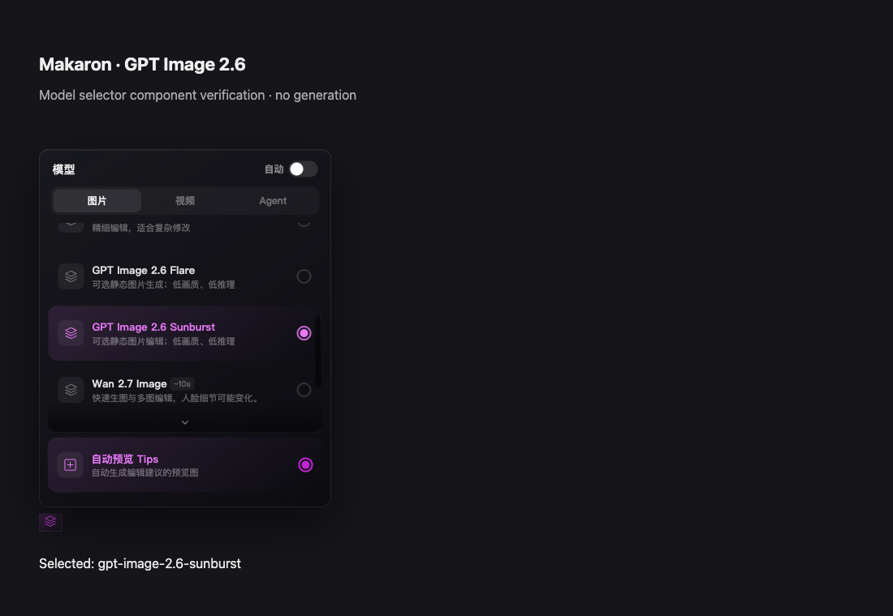
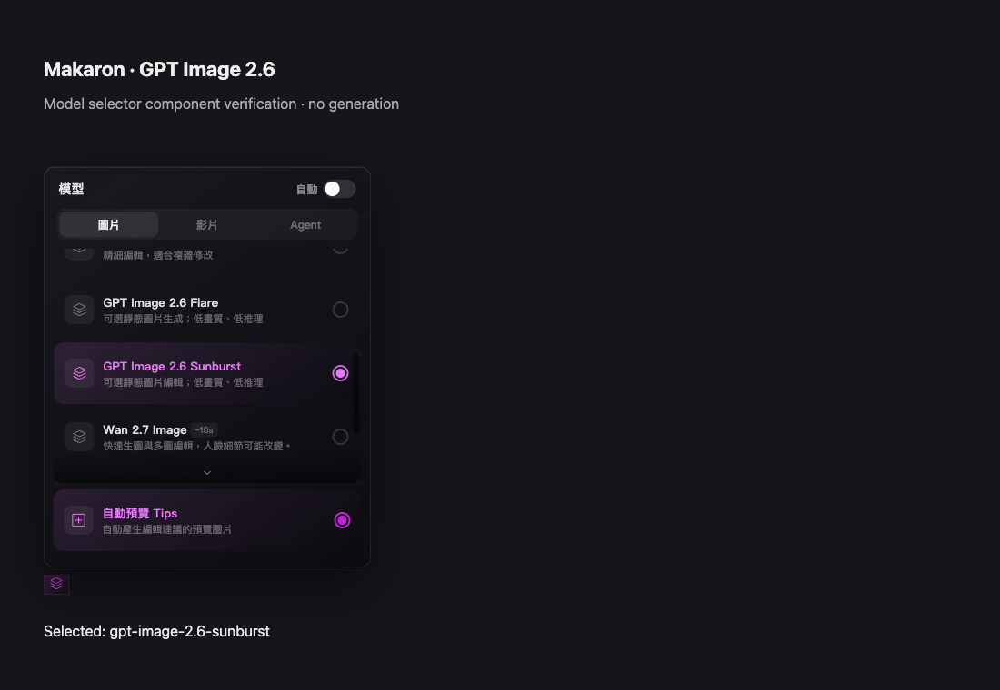
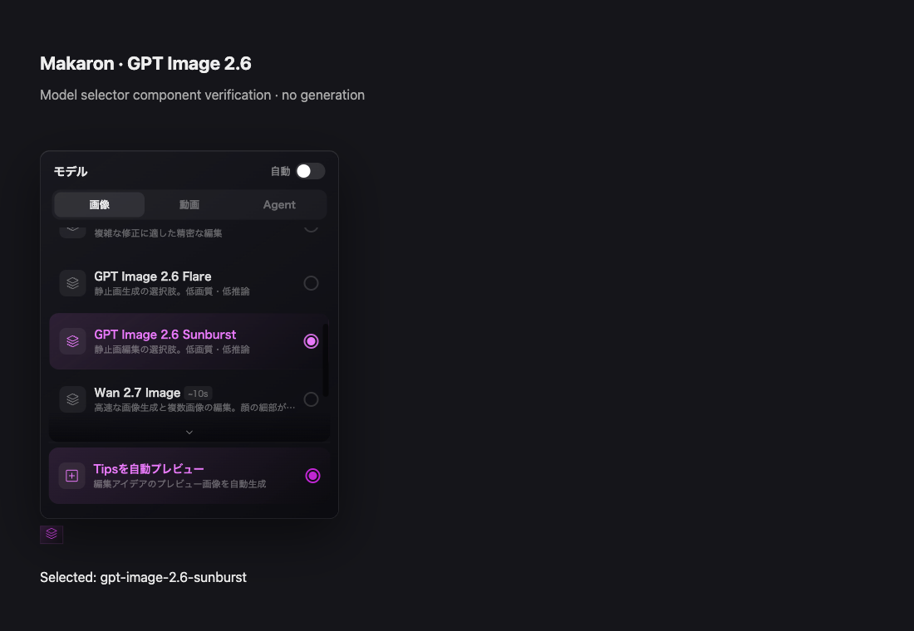
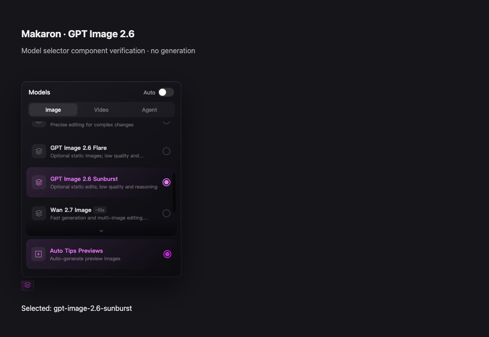
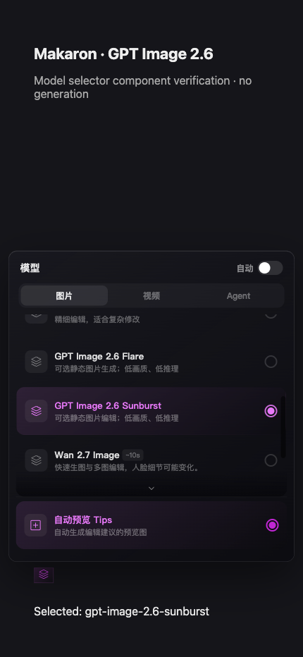

GPT Image 2.6 候选接入（A-20261105-openai-gpt26）

本地候选代码已完成，尚未真实出图验收、合入、部署或发布 CLI。默认仍为 GPT Image 2.5 Flare。没有修改共享数据库或 Preview 配置，本轮实际付费 API 调用 0、费用 $0。

工作树：`/Users/tianyicai/.codex/worktrees/gpt-image26-candidate/ai-image-editor`。分支：`codex/gpt-image26-candidate`。基线：现场核对的 dev `44ff92af51c457e16d9ce4162a5bbf7e25321dfc`。最终提交与完整 diff 记录在雷达目录本轮 `gpt26-integration-result.json` 和 `gpt26-candidate.diff`。

依据与边界：

- [OpenAI 11 月 4 日公告](https://openai.com/index/introducing-images-2-6/)、[API changelog](https://developers.openai.com/api/docs/changelog)、[Flare 模型文档](https://developers.openai.com/api/docs/models/gpt-image-2.6-flare)、[Sunburst 模型文档](https://developers.openai.com/api/docs/models/gpt-image-2.6-sunburst) 已分别读取。
- fal 四个生成／编辑端点正文及完整 OpenAPI schema 已核对。两种模型标注 Commercial use，现有账号对四个精确端点的 pricing GET 均返回 200；这证明价格接口可见，不替代付费推理权限和质量实测。
- 新增显式 `gpt-image-2.6-flare` / `gpt-image-2.6-sunburst`，固定 fal，单张静态 PNG、quality=low、reasoning_effort=low。2.5 的 Segmind 配置不能替换 2.6。保留既有 Auto 和能力冲突处理策略。
- 生成与编辑分发到 `openai/gpt-image-2.6/{flare,sunburst}/{text-to-image,edit}`；参考图按顺序传入，最多 16 张，提示词含参考图标签最多 32000 字符。原生 1K／2K／4K 受 3840 最大边、1:3–3:1、8294400 像素上限约束，正方形 4K 继续由能力规划处理。
- GIF、SVG、透明 PNG 标注层、medium/high quality 不在本次静态链路范围。fal T2I schema 列出 SVG，edit schema 未列出 SVG；没有将两者混为同一合同。未把 GIF 转成静态图冒充支持。
- 后端、注册表、四语选择器、Agent/MCP 参数及计费预检、CLI help/README/bundled Skill/public copies 已同步。普通 PNG 继续走原有保存合同，但真实保存和重新打开尚未验证。

费用与计费：

- fal 公布每百万 text input $5、cached $1.25、text output $10；image input $8、cached $2、output $30。参考图按 image input token 计费，没有固定每张费用。原生 OpenAI 价格页未列出 text output 费，不能把 fal 字段直接当作原生同一合同。
- 生成前读取精确端点 USD/units 单价，结果按 `x-fal-billable-units × unit_price` 记供应商实际费用，沿用原子扣费。没有编造 token 数或按测试 mock 金额报价。
- SQL 迁移只新增两条独立计费行，从各自 2.5 前代复制当前业务 markup；缺少有效前代或已有禁用行时明确失败，不更改现有行。迁移文件未应用、未连接新数据库做 SQL 运行验证。缺独立计费行会在 Agent/MCP 调用供应商前失败，不借用旧型号价格。
- 一次付费 POST 后只查询其原任务；不自动换模型或再次提交。读请求可有限恢复。缺计费结果或返回错误格式时保留任务 ID，停止交付。

验证：

| 检查 | 结果 | 证据 |
|---|---|---|
| 后端、路由、原供应商回归 | 37/37 通过，6 文件 | `gpt26-unit-tests.txt` |
| Agent/MCP HTTP/计费/能力边界 | 218/218 通过，10 文件 | `gpt26-boundary-tests-final.txt` |
| 首轮扩展测试失败 | 22 项失败来自 VM 测试环境仍注入旧 guard 名；已改为导入实际 family guard，原失败日志保留 | `gpt26-boundary-tests.txt` |
| TypeScript | 通过 | `gpt26-tsc-final.txt`（空输出） |
| ESLint | 无错误；Agent 原有 unused locale 警告 1 项 | `gpt26-eslint*.txt` |
| 四语 UI guard | 通过，无新硬编码 UI 文案 | `gpt26-i18n-check.txt` |
| CLI smoke/upload | 通过 | `gpt26-cli-test.txt` |
| CLI 候选包 | 0.17.9 本地 tarball 全新目录安装，6 个发包文件逐字节匹配，4 处版本元数据对齐；未发布和做 registry 安装验收 | `gpt26-cli-package-validation.json`、`makaron-cli-0.17.9.tgz` |
| Skill 生成／副本 | build、startup、discovery 通过 | `gpt26-skill-build-final.txt` |
| 完整 Skill 同步检查 | 未通过：源指纹变化后旧 live routing 证据过期。dry preflight 已组装实际 prompt/23 tools/3 cases，无模型调用；没有伪造 accepted.json。live 预检需要 Agent API 推理费用，超出本次零付费研究范围，保持待验证 | `gpt26-skill-check-final.txt`、`gpt26-routing-dry.txt` |
| 选择器像素／交互 | IAB 首选验证；自动化重复 zh/zh-Hant/ja/en 1100×760 和中文 430×932；选中 2.6、Auto=false、无页面错误 | `gpt26-ui-final.json`、下列截图 |
| 真实 2.6 图片、质量/耗时/费用、保存重开、完整 CUI/CLI 用户路径 | 未执行，不能称 live_verified / ready_for_review / merged / deployed | 无媒体样例，费用 $0 |

UI 验证入口为实际 ModelSelector + LocaleProvider 的独立组件 harness，未启动 Next.js、未访问用户项目或共享数据库；不代表完整编辑器验收。`ui-harness-source.tsx.txt` 留有复现源文件。初次 harness 把底栏控件放在页面上部，导致弹层空间不够；改回实际底栏位置后验证，不涉及产品布局修改。

静态组件截图（不是模型输出）：

